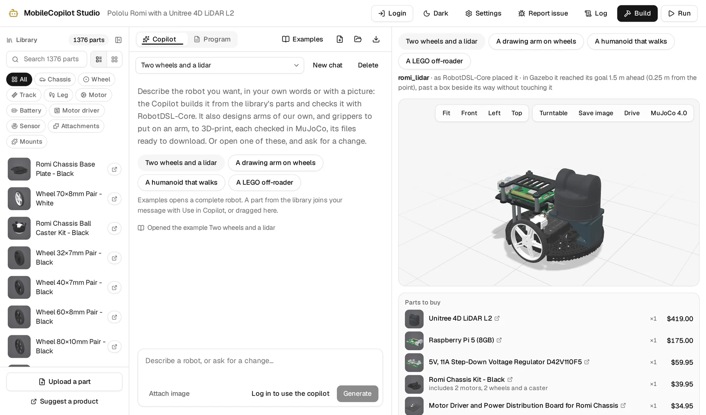

# RobotDSL

**Describe a mobile robot, build it from real parts, check it with a compiler and run it in simulation, in the browser.**

[](https://robotdsl.csail.mit.edu/studio/)

- **[MobileCopilot Studio](https://robotdsl.csail.mit.edu/studio/)**: design a robot, check it, drive it and run it in simulation.
- **[Project page](https://robotdsl.csail.mit.edu/)**: the idea, the video, the results and runs on a real robot.
- **[Documentation](https://robotdsl.csail.mit.edu/docs/)**: the language, what the compiler checks and how to run what it writes.

RobotDSL is a language and a compiler for mobile robots. A program states the robot, the world it drives in, its task and how a run is judged. The compiler assembles the robot from a library of real parts, checks the whole against itself and writes the files that ROS 2, Gazebo and MuJoCo run.

This repository is the project's public site: the project page, the Studio, the documentation and the pages for printing our own robots.

## Try it

Open **[MobileCopilot Studio](https://robotdsl.csail.mit.edu/studio/)**. There is nothing to install, and looking around needs no account.

- **Start from a robot.** "Two wheels and a lidar", "A drawing arm on wheels", "A humanoid that walks" and "A LEGO off-roader" each open a complete robot, and **Examples** holds over a hundred more.
- **Build from real parts.** The library holds over 1,300 chassis, wheels, tracks, legs, motors, batteries, motor drivers, sensors and attachments, each with its 3D model, its price and a link to its maker's page. The Studio lists the parts to buy and what they cost.
- **Check it and run it.** **Build** has the compiler check the robot. **Drive** steers it in the page. **Run** simulates its task in Gazebo or MuJoCo with ROS 2 and Nav2 and replays the run in the 3D view.
- **Ask the Copilot.** Describe the robot you want, in words or with a picture. The Copilot builds it from the library's parts and corrects it from what the compiler finds. It runs on your own OpenAI, Anthropic or Google API key.
- **Take it with you.** **Download** gives the program, the files for Gazebo and for MuJoCo with ROS 2 and Nav2, the files for MuJoCo alone, and the parts to buy.

## Print a robot

Ten robots of our own design each have a page with every piece to print, the print settings, a shopping list and build notes: the [Hexapod](https://robotdsl.csail.mit.edu/print/robotdsl_hexapod/), the [Quadruped](https://robotdsl.csail.mit.edu/print/robotdsl_quadruped/), the [Dog](https://robotdsl.csail.mit.edu/print/robotdsl_dog/) and the [Biped](https://robotdsl.csail.mit.edu/print/robotdsl_biped/), and six arms: the [Arm](https://robotdsl.csail.mit.edu/print/robotdsl_arm/), the [Compact Arm](https://robotdsl.csail.mit.edu/print/robotdsl_arm_compact/), the [Long Arm](https://robotdsl.csail.mit.edu/print/robotdsl_arm_long/), the [Six-Axis Arm](https://robotdsl.csail.mit.edu/print/robotdsl_arm_six/), the [Pick Arm](https://robotdsl.csail.mit.edu/print/robotdsl_arm_pick/) and the [Drawing Arm](https://robotdsl.csail.mit.edu/print/robotdsl_arm_draw/).

## Take part

Questions, reports and parts all come in through this repository, with a GitHub account. [CONTRIBUTING.md](CONTRIBUTING.md) says what each one needs and what becomes of it.

| You want to | Go to |
| --- | --- |
| Ask a question, show a robot or propose an idea | [Discussions](https://github.com/MIT-CDFG/robotdsl-site/discussions) |
| Report a robot that came out wrong | **Report issue** in the Studio, or [Generated design looks wrong](https://github.com/MIT-CDFG/robotdsl-site/issues/new?template=generated-design.yml) |
| Report a problem with the site or the Studio | [Site or Studio problem](https://github.com/MIT-CDFG/robotdsl-site/issues/new?template=site-problem.yml) |
| Offer a product, or a part of your own, for the library | **Suggest a product** in the Studio, or one of the [Submit a … forms](https://github.com/MIT-CDFG/robotdsl-site/issues/new/choose) |
| Ask for a part the library lacks | [Request a part](https://github.com/MIT-CDFG/robotdsl-site/issues/new?template=part-request.yml) |
| Fill in or correct a figure of a part | [Propose a part's figures](https://github.com/MIT-CDFG/robotdsl-site/issues/new?template=part-figures.yml) |

## This repository

The site is static: every file here is served as it is, at https://robotdsl.csail.mit.edu/ within a minute of a push to `main`, and by GitHub Pages at https://mit-cdfg.github.io/robotdsl-site/.

| Path | What it holds |
| --- | --- |
| `index.html`, `assets/` | The project page. |
| `studio/` | MobileCopilot Studio as built, with its catalog of parts and example robots. The parts' 3D models are read from the library's dataset on Hugging Face, [Aki-Frank/robotdsl-parts](https://huggingface.co/datasets/Aki-Frank/robotdsl-parts). |
| `docs/` | The documentation as built, for the path `/robotdsl-site/docs/`. |
| `print/` | The print pages. |
| `guide/` | Forwards an earlier address to the documentation. |
| `.github/ISSUE_TEMPLATE/` | The forms listed above. |

The sources of the Studio, the compiler and the parts library are not public yet, and `studio/` and `docs/` here are built from them. A fix to either therefore starts as an issue, not as a pull request to the built files.

### Previewing it

There is no build step. Serve the folder over HTTP, since the 3D views load modules and do not work from a file:

```console
python3 -m http.server 8769 --bind 127.0.0.1
```

and open http://127.0.0.1:8769/. The documentation is built for the path `/robotdsl-site/docs/`; to see it too, serve the folder under that name and open http://127.0.0.1:8769/robotdsl-site/:

```console
mkdir -p /tmp/robotdsl-preview && ln -sfn "$PWD" /tmp/robotdsl-preview/robotdsl-site
python3 -m http.server 8769 --bind 127.0.0.1 --directory /tmp/robotdsl-preview
```

Build and Run ask the project's server, which answers only pages served from the two published addresses, so they do not work in a local preview.

### Changing the project page

`index.html` loads `assets/base.css`, `assets/site.css` and `assets/site.js` with `?v=` set to the first 8 characters of the file's SHA-256 (`sha256sum assets/site.js | cut -c1-8`). After changing one of them, update its `?v=` in `index.html`, or a browser can pair the new page with its cached copy of the old file.

## Licence and citation

The project page's content is under CC BY 4.0. The Studio is published to be used through this site, with all rights reserved. The robots, models and third-party files keep the licences that [LICENSE.md](LICENSE.md) names, and [docs/asset-sources.md](docs/asset-sources.md) lists the third-party files and where the page's figures come from.

```bibtex
@misc{robotdsl_mobilecopilot,
  title        = {MobileCopilot: A Domain-Specific Language Framework
                  for Agentic Mobile Robot Design},
  author       = {Akihisa Watanabe and Fang Jiawei and Zhiyang Dou and
                  Yuxin Ray Song and Zizhao Tong and Yunsheng Tian and
                  Minghao Guo and Benjamin Jones and Wojciech Matusik},
  howpublished = {\url{https://robotdsl.csail.mit.edu/}}
}
```
